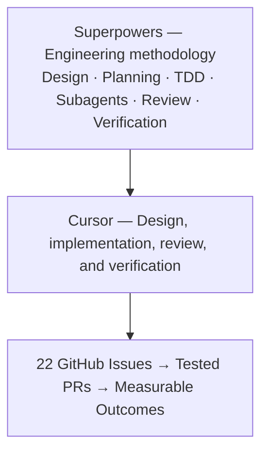

# Superpowers Adoption — NorthStar eCommerce Analytics Harness

> **Status:** Adoption and mastery plan. Descriptions of planned capabilities are not claims of completed implementation.

Superpowers is the engineering methodology for this repository. The goal is to master that methodology while building the NorthStar company harness as a closed-layer system, and to be able to show that on a Chief Architect resume through merged work, tests, and evidence.

The teaching source is the flat [ns-work-harness](https://github.com/aishwaryanr/awesome-generative-ai-guide/tree/main/youtube/code/ns-work-harness). This repo keeps the company facts and the four operations, and builds them as [ARCHITECTURE.md](ARCHITECTURE.md) and [DESIGN.md](DESIGN.md) describe. `deepagents` is the agent library for the later harness. It is not the methodology.

## 1. Strategy

Use Superpowers inside Cursor for the whole lifecycle. Claude Code and Codex are later options. They are not part of the current execution path.

## 2. Superpowers mastery plan

Six weeks, using the GitHub issues already filed for this repo as the exercises.

| Week | Superpowers capabilities | Hands-on GitHub issues |
|---|---|---|
| 1 | Brainstorming, writing plans, Git worktrees | MW-001, MW-002, MW-003 |
| 2 | TDD, systematic debugging, verification | DOM-001, DOM-002 |
| 3 | Subagent-driven development, code review | DOM-003, DOM-004, DOM-005 |
| 4 | Failure cases and access reviews | DOM-006, ACC-001, ACC-002 |
| 5 | Context boundaries and agent composition | CTX-001, CTX-002, HRN-001, HRN-002 |
| 6 | Approval, persistence, and evidence | HRN-004, HRN-006, HRN-009 |

*These are learning targets, not a promise that every issue closes inside six weeks. M7 and M8 stay blocked on a stable middleware contract.*

### What mastery should look like

For each issue, capture evidence that the methodology was followed:

- An approved design or a documented decision, pointing at ARCHITECTURE.md or DESIGN.md when the issue does not change them.
- A task-level implementation plan with file paths.
- A dedicated Git branch or worktree. Do not implement on `main`.
- Tests demonstrating red-green-refactor where the issue has acceptance criteria.
- Implementation commits and code review findings.
- Verified acceptance criteria and a linked pull request.

After several issues, you should be able to explain why a particular Superpowers skill was used, where it improved the work, and where it added overhead.

## 3. Architectural leadership, not tool installation

The resume claim is the closed-layer harness, not the fact that a plugin was installed. Track these through the issues:

| Metric | What it demonstrates |
|---|---|
| Issues completed using Superpowers | Adoption across middleware, domains, and harness |
| PRs with design notes and test evidence | Engineering governance |
| Closed-layer import audit pass rate | The architecture is enforced, not described |
| Role-matrix pass rate | Application-owned access |
| Outbox rows written only after harness approval | The send boundary holds |
| Provider calls avoided until HRN-009 | Cost stays explicit |

Do not claim a productivity percentage unless a baseline is measured.

## 4. Resume positioning

Use this only after the named capabilities are implemented and validated. Until then, describe the work as an ongoing independent project.

### NorthStar eCommerce Analytics Harness — Chief Architect / Independent Engineering Project

**Technologies:** Superpowers, Cursor, Python 3.13, uv, FastAPI, FastMCP, deepagents, SQLite.

- Architected an internal company harness for an analytics business, with customer, issue, financial, and proposal operations behind a closed presentation, business, service, persistence, and database stack.
- Applied the **Superpowers AI-assisted software engineering methodology** across design, implementation planning, test-driven development, subagent execution, code review, and verification.
- Kept employee role, human approval, and company records under application control, with MCP and REST entrypoints that accept one domain context and do not take free arguments.
- Separated the company database from harness working files and task checkpoints, and kept `deepagents` outside the domain packages.

**These bullets describe the intended completed project. Don't use them as completed accomplishments yet.**

## 5. What to do now

Start with **MW-001 / GitHub issue #1** in Cursor Agent + Superpowers. Brainstorm, plan, worktree, tests, review, and verification stay in Cursor.

The story to earn is: *I architected a company AI harness as a closed domain middleware plus a deepagents composition root, and I delivered it with a repeatable, test-first engineering method.*

That is a stronger Chief Architect story than listing Superpowers as a tool name.

---

**Execution companion:** [SUPERPOWERS_GitIssues_OperatingModel.md](SUPERPOWERS_GitIssues_OperatingModel.md).

**Issue log:** [SUPERPOWERS_GitIssues_Progress.md](SUPERPOWERS_GitIssues_Progress.md).
